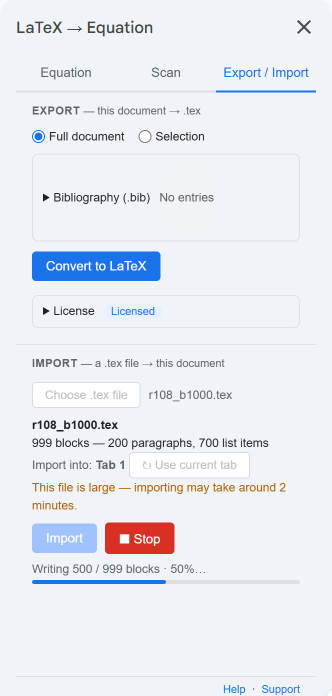

<!-- R138 (added): v16 speed post. R180: v16 live 10-30, v17 11-02; progress is a percentage (R146), large-file
     notice (R148, timings R144 real sidebar), Continue import only choice (R157). Sources: .tmp/r108_import_speed_fix.md §6, .tmp/r111_import_speed2.md §0, .tmp/r123_review2_fixes.md,
     .tmp/r120_autolatex_handson.md §1 (live v15 Convert All), .tmp/r132_convert_budget12.md §5 (v16 Convert All).
     Re-check the figures against .tmp/r137_p4.md before merging. -->

[Version 16](/latexflow/changelog/) of the LaTeXFlow add-on for Google Docs™ is mostly about speed in two places: **Import**, which brings a `.tex` file into a document, and **Convert All** on the Scan tab, which turns the LaTeX in a document into equations. This post gives the times we measured, how we took them, and what can still make a run slower.

## 1. Import: a large .tex file now finishes

The test file has 999 blocks: 200 paragraphs and 700 list items, some of them nested. We imported it into a new, empty document from the sidebar, as a user would.

| | Version 15 (live add-on) | Version 16 |
|---|---|---|
| Run 1 | stopped at block 860, after about 413 s | — |
| Run 2 | stopped at block 540, after 238 s | — |
| Whole file | did not finish (0 of 2 runs) | **999 of 999 in about 65 s** |
| Time to reach block 500 | 158 s | well under a minute |

Both Version 15 runs ended with the same Google Docs™ message, "Service Documents failed while accessing document", and left the document half written. Version 15 also slowed down as it went: the first 100 blocks took about 15 s, and by block 500 each 100 blocks took about 80 s.

Version 16 writes fewer changes for each list item and saves in larger steps, so the whole file is written in 4 steps, and in our runs Docs did not fail on it.

While it runs, the sidebar shows how many blocks are written and what share of the file that is, for example "Writing 491 / 1272 blocks · 38%". A file large enough to take a few minutes says so as soon as you pick it, with a rough number of minutes. In our tests a file of about 1,270 blocks took about 2 minutes, and one of about 4,600 blocks about 12.

{: width="330" }

### If Google Docs™ stops part-way

Google Docs™ can still fail on a step now and then, for reasons on its side. Version 16 does not leave you with half a document and no way on. The sidebar says what happened and shows **Continue import** as the only choice, which carries on from the block where it stopped. In our tests with failures injected on purpose, every continued import ended with the same document as an import that never failed.

{: width="330" }

## 2. Convert All: several times faster

We used one test text with a mix of inline and display equations: fractions, sums, integrals, matrices, `cases`, `align`, numbered equations, equations in table cells, and lines written in Korean. Each run started from a fresh scan.

| | Version 15 (live add-on) | Version 16 |
|---|---|---|
| The test text, 3 runs each | 35 equations in 90.5–102 s | 33 equations in 22.6–25.0 s |
| Per equation | about 2.7 s | about 0.7 s |

Scan found 35 equations in the Version 15 copy of the text and 33 in the Version 16 copy, so compare the per-equation times.

Larger documents in Version 16:

| Equations | Time |
|---|---|
| 132 | about 100 s |
| 330 | about 237 s |

The first equation appears in the document after about 4 seconds, so you can see that it is working.

Version 15 sent equations to Google Docs™ one at a time and waited for each. Version 16 sends them in batches, and renders the next equations while Docs is inserting the current ones.

**Stop** now finishes the batch it is on before it stops, so it can take several seconds; the sidebar says it is stopping after the current batch. Anything not yet converted stays as LaTeX text, and you can run Convert All again later.

## 3. Why your times may differ

Most of the time in both features is Google Docs™ itself: opening the document, inserting, and saving. That part changes from day to day. In our test runner, the same 999-block import took anywhere from about 46 s to about 103 s depending on the hour. For Convert All, the time Docs takes to insert one equation went from about 0.52 s to about 0.64 s between two days, with the same code.

So treat the numbers above as typical, not guaranteed. A long document still takes a while; it now finishes.

## 4. Getting Version 16

Google Docs™ updates add-ons on its own, so there is nothing to install. If the sidebar still shows the tabs **Input** and **LaTeX file**, close it and open it again from **Extensions › LaTeXFlow**; Version 16 calls them **Equation** and **Export / Import**.

Version 17 followed on 2 November 2026 with fixes for Scan, Revert and Export; it is listed on the same page.

Scan and Convert All are free. Import and Export need a license key.

- What else changed: [What's new](/latexflow/changelog/)
- Import, step by step: [You Received a .tex File: Editing It Together in Google Docs™](/blog/en/posts/tex-file-into-google-docs-import/)
- License keys: [LaTeXFlow store](https://teolemma.lemonsqueezy.com/?utm_source=blog&utm_medium=post&utm_campaign=latexflow-version-16-faster-import-convert-all)
