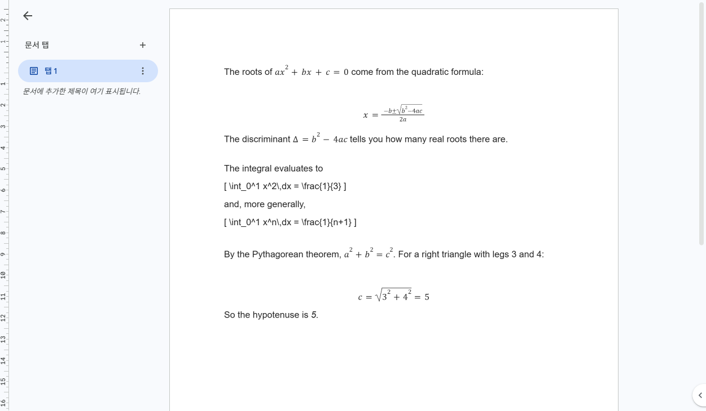
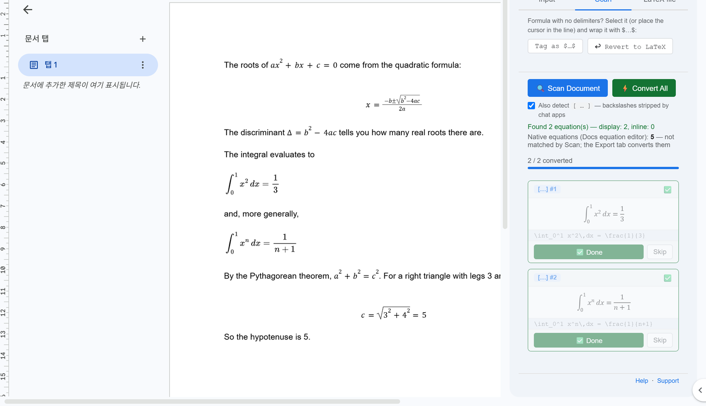
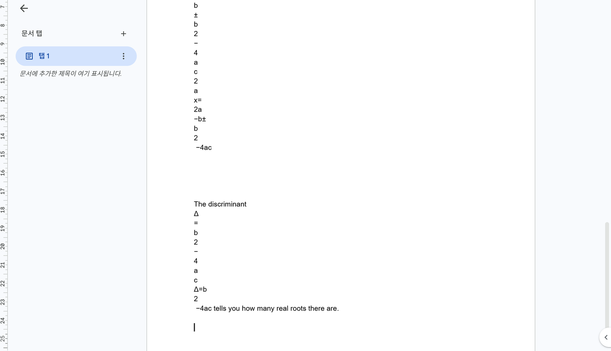

챗지피티 수식을 구글 독스(Google Docs™)에 붙여 넣을 때는 답변 아래의 **복사 버튼** 으로 복사해서 붙여 넣으면 됩니다. 일부 수식은 구글 독스가 붙여 넣는 순간 스스로 수식으로 바꾸고, LaTeX 글자로 남은 것은 무료 LaTeXFlow 애드온의 Scan 한 번으로 바꿀 수 있습니다.

수식이 깨지는 가장 흔한 원인은 화면에 보이는 수식을 **마우스로 드래그해 복사** 하는 것입니다. 이 경우는 뒤에서 따로 다룹니다. 아래는 2026년 10월 28일에 직접 붙여 넣어 확인한 결과입니다.

## 1. 붙여 넣어 본 답변

챗봇 답변에 흔히 나오는 모양 네 가지로, 수식은 모두 7개입니다.

| 모양 | 예 | 개수 |
|---|---|---|
| 챗지피티식 `\(…\)`, `\[…\]` | 근의 공식, 판별식 | 3 |
| 백슬래시가 빠진 맨 대괄호 `[ … ]` | 적분 두 줄 | 2 |
| 제미나이식 `$…$`, `$$…$$` | 피타고라스 정리 | 2 |
| 채팅 창에 그려진 수식을 드래그 | 근의 공식 | — |

빈 구글 독스 문서에 `Ctrl` + `V`(일반 붙여넣기)와 `Ctrl` + `Shift` + `V`(서식 없이 붙여넣기)로 각각 붙여 넣었습니다. 계정은 Marketplace 에서 애드온을 설치한 일반 구글 계정입니다.

## 2. 붙여 넣는 순간 구글 독스가 하는 일

{: width="720" }

| 모양 | 붙여 넣은 뒤 (이 계정) |
|---|---|
| `\(…\)`, `\[…\]` | 구글 독스 수식 |
| `$…$`, `$$…$$` | 구글 독스 수식 |
| 맨 `[ … ]` | LaTeX 글자 그대로 |
| 드래그해 복사한 수식 | 글자가 흩어져 깨짐 |

두 가지 붙여넣기 모두 결과가 같았습니다. 7개 중 5개는 애드온 없이 구글 독스가 바로 수식으로 바꿨습니다. 분수와 루트가 들어간 근의 공식도 바뀌었습니다.

다만 이 자동 변환은 구글 독스의 기능이라 **계정마다 범위가 다릅니다**. 앞서 시험한 다른 계정에서는 짧은 `$\pi r^2$` 는 바뀌고 긴 `$$x = \frac{-b \pm \sqrt{b^2-4ac}}{2a}$$` 는 글자로 남았습니다. 그러니 붙여 넣은 뒤에는 이미 수식이 된 것과 아직 LaTeX 인 것이 섞여 있다고 보면 됩니다.

## 3. 남은 LaTeX 를 수식으로 바꾸기

LaTeX 글자로 남은 수식은 애드온이 찾아서 바꿉니다.

1. **확장 프로그램 › LatexFlow › Open Equation Panel** 로 사이드바를 엽니다. 처음이라면 [설치부터 첫 변환까지](/blog/posts/latexflow-addon-install-first-conversion/) 를 먼저 보세요.
2. **Scan** 탭에서 **Also detect [ … ]** 를 체크합니다. 맨 대괄호 모양을 잡는 옵션이고, 애드온에서는 기본으로 꺼져 있습니다.
3. **Scan Document** 를 누릅니다.

![LaTeX 로 남은 적분 두 줄 옆의 Scan 탭: Also detect [ … ] 체크, Found 2 equation(s) — display: 2, inline: 0, Native equations: 5, 적분 두 개의 미리보기 카드](/assets/img/posts/2026-11-12/02-scan-found.png){: width="720" }

Scan 은 구글 독스가 남겨 둔 대괄호 수식 **2개** 를 찾았고, 구글 독스가 이미 바꾼 수식은 **Native equations: 5** 로 따로 셌습니다. 2 + 5 = 7 이라 빠진 수식이 없습니다.

4. **Convert All** 을 누릅니다.

{: width="720" }

두 줄 모두 수식이 되었습니다(**2 / 2 converted**). 이제 문서 안의 수식 7개가 모두 수식으로 보입니다. 바꾼 수식에는 LaTeX 원문이 저장되어 있어서, 고칠 때는 **Revert to LaTeX** 로 원문으로 되돌릴 수 있습니다.

## 4. 되살릴 수 없는 복사 — 드래그

채팅 창에 그려진 수식을 마우스로 드래그해 복사하면, 구글 독스에는 LaTeX 원문이 아니라 화면에 보이는 글자만 들어옵니다. 시험에서는 기호가 한 줄에 한 글자씩 흩어지고 같은 식이 두세 번 반복되었습니다.

{: width="720" }

이 문서는 Scan 해도 찾을 것이 없습니다. 읽을 LaTeX 가 남아 있지 않기 때문입니다. 해결은 복사하는 단계에 있습니다. 답변 아래 **복사 버튼** 을 쓰면 LaTeX 원문까지 함께 복사됩니다. 처음부터 LaTeX 로 달라고 요청하는 방법은 [ChatGPT 에 수식을 요청하는 올바른 방법](/blog/posts/chatgpt-math-request-format/) 에 있습니다.

## 5. 제미나이 수식이 깨질 때 — 달러 기호 형식

제미나이는 수식을 보통 `$…$`(문장 안)와 `$$…$$`(따로 한 줄)로 씁니다. 이 모양은 복사 버튼으로 복사하면 그대로 따라오고, 위 시험에서는 구글 독스가 붙여 넣는 순간 수식으로 바꿨습니다.

계정에 따라 일부가 `$$…$$` 글자로 남아 있다면, 깨진 것이 아니라 아직 수식으로 바뀌지 않은 LaTeX 입니다. 3절 순서대로 **Scan Document** › **Convert All** 을 누르면 됩니다. 달러 기호 모양은 기본으로 잡히므로 **Also detect [ … ]** 는 체크하지 않아도 됩니다. 드래그로 복사했다면 4절과 같은 이유로 되살릴 수 없으니, 복사 버튼으로 다시 복사해 붙여 넣으세요.

## 6. 자주 묻는 질문

**챗지피티 수식은 어떻게 복사하나요?**
답변 아래의 복사 버튼을 누릅니다. 수식이 LaTeX 원문 그대로 복사되어, 구글 독스에서 수식으로 바뀌거나 LaTeX 로 남아 애드온이 바꿀 수 있는 상태가 됩니다.

**AI 수식을 어떻게 변환하나요?**
구글 독스에 붙여 넣은 뒤 LaTeX 로 남은 것만 Scan › Convert All 로 바꿉니다. 제미나이 답변의 `$…$`, `$$…$$` 도 같은 순서입니다. 워드(.docx) 문서라면 설치 없이 쓰는 [웹 버전](/latexflow/web/) 이 같은 일을 합니다.

**구글 독스가 이미 다 바꿨으면 애드온은 필요 없나요?**
보이는 것만 보면 필요 없습니다. Scan 의 **Native equations** 숫자가 구글 독스가 바꾼 수식의 개수입니다.

**붙여 넣은 LaTeX 를 글자 그대로 두고 싶어요.**
붙여 넣으면 계정에 따라 구글 독스가 바꿀 수 있어서 확실하지 않습니다. 직접 타이핑한 LaTeX 는 글자로 남습니다.

## 7. 정리

1. 챗지피티·제미나이 답변은 **복사 버튼** 으로 복사합니다. 드래그 복사는 되살릴 수 없습니다.
2. 구글 독스에 붙여 넣으면 일부는 그 자리에서 수식이 됩니다.
3. LatexFlow 의 **Scan** 탭에서 **Also detect [ … ]** 를 켜고 **Scan Document**.
4. **Convert All** 을 누르면 남아 있던 LaTeX 까지 모두 수식이 됩니다.
