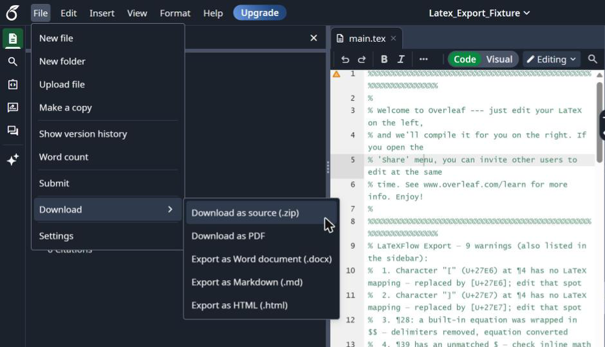

Overleaf cannot export to Google Docs™, so to move an Overleaf project into Docs you download its source as a `.zip` and import the `.tex` from it. LaTeXFlow **Import** writes the headings, lists, tables and equations into the document; the `.bib` file and the figures from the same `.zip` go in with two short steps of their own.

A single short `.tex` file is covered in [You Received a .tex File](/blog/en/posts/tex-file-into-google-docs-import/), part by part. This post is about what a real Overleaf project adds: chapters split into several files, a separate `refs.bib`, and a folder of figures.

## 1. Download the project from Overleaf

1. Open the project in Overleaf.
2. Choose **File** in the upper left of the editor, then **Download as source (.zip)**. From the project list, the **Download .zip file** button does the same.
3. Unzip the file on your computer.

{: width="720" }

A typical thesis or paper project unzips into something like this:

```
main.tex
chapters/introduction.tex
chapters/method.tex
refs.bib
figures/setup.png
figures/results.pdf
```

`main.tex` holds the preamble and pulls the chapters in with `\input{chapters/introduction}`. That line matters for the next step.

## 2. Import the .tex files, in order

Import reads one `.tex` file at a time and does not follow `\input` or `\include`. A chapter file without `\documentclass` or `\begin{document}` is fine: Import reads it as body text.

1. Open an empty Google Docs™ document.
2. Open LaTeXFlow (**Extensions → LatexFlow → Open Equation Panel**) and go to the **Export / Import** tab.
3. Press **Choose .tex file** and pick `main.tex`. The sidebar lists what it read and what will change on the way in. Nothing is written yet.
4. Press **Import**.
5. Pick the next file, `chapters/introduction.tex`. Import writes at the end of the tab shown after **Import into:**, and since the tab now has content, tick **Append anyway**, then press **Import**.
6. Repeat for each chapter in the order `main.tex` lists them.

{: width="720" }

`\section` and `\subsection` become Docs headings, lists become Docs lists and `tabular` becomes a Docs table. Equations arrive as LaTeX text between delimiters, so you can still edit them as source. The sidebar shows how far it has got as a percentage; a file of about 1,000 blocks took about a minute in our tests. If Google Docs™ stops part-way, **Continue import** carries on from the block where it stopped.

If you would rather keep each chapter apart, add a document tab for each one and import it there instead of appending.

## 3. Paste refs.bib into the Bibliography

A separate `refs.bib` is not inside any `.tex` file, so Import cannot read it. When `main.tex` has `\bibliography{refs}`, the pick summary says so in a note and points to where the entries go. The citations still come in: each `\cite{key}` is written as a `[@key]` marker.

1. Open `refs.bib` from the unzipped folder in any text editor and copy all of it.
2. On the **Export / Import** tab, open **Bibliography (.bib)**, paste the entries and press **Save**.

The entries now belong to the document. When it is exported back to LaTeX, every `[@key]` becomes `\cite{key}` again and the entries go back into the `.tex`, so leave the markers as they are while you edit.

If the project keeps its `.bib` inside `main.tex` in a `filecontents` block, Import saves it to the Bibliography by itself and there is nothing to paste.

## 4. Put the figures back

A `.tex` file names its figures but does not contain them. Where `\includegraphics{figures/setup.png}` was, the document has a bold line:

```
[Image: setup.png — insert here]
```

1. Click on that line.
2. In Docs, choose **Insert → Image → Upload from computer** and pick the file from the `figures` folder of the `.zip`.
3. Delete the placeholder line.

Searching the document for `[Image:` finds every placeholder. A figure saved only as PDF needs to be converted to PNG or JPG first, since Docs does not insert PDF files as images.

## 5. Make the equations visible

Until now the maths is LaTeX text, which is what you want while the wording is still changing. When readers need to see rendered maths, open the **Scan** tab, press **Scan Document**, then **Convert All**. Each equation becomes an image and keeps its LaTeX, and **Revert to LaTeX** turns the images you select back into source; **Revert all** does the whole tab after asking.

Scan, Convert All and Revert are free. Import and Export are the paid part of LaTeXFlow.

## 6. FAQ

**Can I export from Overleaf to Google Docs™?**
Not directly: Overleaf has no Google Docs™ export. Download the source as a `.zip` and import the `.tex` into Docs with an add-on (sections 1 and 2).

**Is there a free way?**
Yes, for the text and maths only: paste the body of each `.tex` into Docs and convert the equations with the free Scan. Headings, lists, tables and citations are then redone by hand. [How to Convert a LaTeX File to Google Docs™](/blog/en/posts/latex-file-into-google-docs-what-works-today/) walks that path.

**Will the project still compile in Overleaf after editing in Docs?**
Export writes the document back as a `.tex` with its bibliography, ready to open in Overleaf. What changes in a round trip is listed in [Docs → .tex → Docs](/blog/en/posts/google-docs-latex-round-trip/).

**Overleaf or Google Docs™?**
Both, for different people. Writing and compiling stay in Overleaf; co-authors who do not use LaTeX can comment and suggest edits in Docs. Import and Export move the text between them.

## 7. Summary

1. Overleaf: **File → Download as source (.zip)**, then unzip.
2. Docs: LaTeXFlow **Export / Import** tab, import `main.tex`, then each chapter with **Append anyway**.
3. Paste `refs.bib` into **Bibliography (.bib)**.
4. Replace each `[Image: …]` line with the figure from the `.zip`.
5. **Scan → Convert All** when the maths should be rendered.

- License keys: [LaTeXFlow store](https://teolemma.lemonsqueezy.com/?utm_source=blog&utm_medium=post&utm_campaign=overleaf-to-google-docs)
- Activation, cancelling and refunds: [Export & Import guide](/latexflow/export/)
