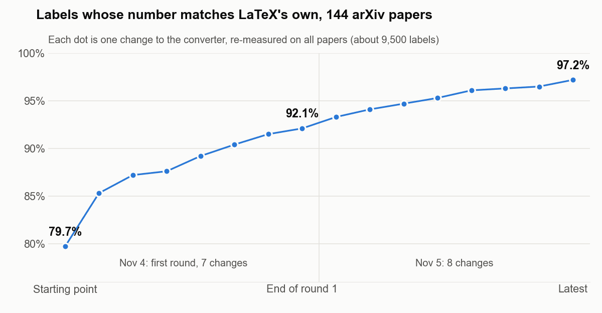

<!-- R225 (2026-11-05). Launch sequence post 2 of 4 (plan: addon repo docs/marketing_docs/tex2docx_launch_sequence_2026-11-05.md). Numbers: addon repo .tmp/r210_p1_phase1.md (R209 baseline 79.7%, R210 92.1%, G2 Word check, free-route row) and .tmp/r222/progress.md (94.7% at writing). Rules: no competitor or product names, no price, no limitation list, no release date. -->

In [the last post](/blog/en/posts/latex-to-word-document-coming/) we showed one passage of a paper converted to Word two ways: once by the usual free route, where "(1.1)" turned into "([expansion])" and the citations vanished, and once by the converter we are building, where every number was where the PDF puts it.

The fair question is: does that hold up beyond one hand-picked page? This post is the answer, in two parts — how the numbers are built, and how we check them.

**[Get notified when it's ready →](/latexflow/web/?utm_source=blog&utm_medium=post&utm_campaign=tex2docx_waitlist#tex2docx-notify)**

## 1. Word does not know what "equation (2.4)" is

In LaTeX, you never type a number. You write `\label{eq:energy}` under an equation and `\eqref{eq:energy}` in the text, and when the paper compiles, LaTeX counts: this is the fourth equation of section 2, so it is (2.4), and every reference to it prints "(2.4)". The same counting gives you Theorem 3.1, Figure 5 and Section 4.2.

A `.docx` file has nothing like that. Word has no built-in notion of an equation number at all. So a converter has two choices:

- **Type the numbers in as text.** It looks right on the first screen. Then your co-author adds an equation in section 1, and every number after it is wrong, with nothing to tell anyone.
- **Rebuild LaTeX's counting out of Word's own machinery.** That is what we do.

Word does have the parts. A *SEQ field* is a counter: each one shows the next number in its sequence, and it can restart when a new section begins. A *bookmark* gives a spot in the document a name. A *REF field* prints whatever is inside a named bookmark. Put together:

- each equation number becomes the section's SEQ field, a dot, and the equation's SEQ field, wrapped in a bookmark named after the LaTeX label;
- each `\eqref` becomes a REF field that points at that bookmark;
- theorems, figures, tables and headings get their own sequences, counted the way your document class counts them.

Press Alt+F9 in Word and you see the fields instead of the numbers:

{: width="720" }
_Field codes in our output (Alt+F9). "Theorem 1.1" is the section counter plus a theorem counter; "(1.2)" is the section counter plus the equation counter. Alt+F9 again shows the numbers._

The result behaves like a Word document that was numbered in Word from the start. Move a section, update the fields (select all, F9), and the numbers and every reference to them follow.

The hard part is not writing the fields. It is getting the *counting* right, because LaTeX's counting depends on the document class, the packages and the preamble. Some papers number equations within sections, some straight through; some theorems share a counter with lemmas, some don't; an appendix switches sections to letters. If the converter counts differently from LaTeX even once, a number is wrong. So we needed a way to check it, paper by paper.

## 2. How we score ourselves: LaTeX grades the test

When LaTeX compiles a paper, it writes a small side file, the `.aux`, with one line per label: this label got number 2.4, that one got Theorem 3.1. That file is the answer key, and it comes from LaTeX itself, not from us.

So the test goes like this:

1. **Take 144 arXiv papers that compile** — mathematics, physics, computer science, statistics and other fields, each with its own class and preamble.
2. **Compile each one with pdflatex** and keep its `.aux`.
3. **Convert each `.tex` to `.docx`**, without looking at the `.aux`. The converter has to do the counting itself.
4. **Compare every number one by one**: each label, each printed reference, each theorem, each caption, each citation, against the `.aux`. About 9,500 labels in all.
5. **Open every output in Microsoft Word.** In our last full check, all 150 documents we converted opened without a repair prompt, and when Word updated all 58,742 fields, not one equation number or reference changed. What you see when you open the file is what Word itself computes.

The usual free route goes through the same answer key, measured the same way. On it, the free route matched none of the labelled equation numbers, and printed 18% of the references right, all of them as plain text.

## 3. Where it stands, and what is hard

When we started measuring, 79.7% of the labels came out with LaTeX's number. Since then, every change to the converter has been re-measured on all 144 papers.

{: width="720" }
_Each dot is one change to the converter, re-measured on all 144 papers. At the time of writing: 94.7% of about 9,500 labels match LaTeX's `.aux`._

The first round was the common machinery: counters an author defines in the preamble, lists with custom labels, numbered rows inside multi-line equations, the way some journal classes number tables and sub-headings. The second round is the long tail, and it is where the interesting work is:

- **Labels hidden inside an author's own commands.** Many papers wrap environments in shorthand macros of their own, sometimes with a label inside. The converter has to read the macro the way TeX does before it can find the label.
- **Counters changed in the middle of a paragraph.** An author who writes "skip one equation number here" with a counter command, or who starts the appendix mid-page, changes every number after that point. Miss it once and the rest of the section is off by one.
- **Grouped equations numbered 2a, 2b, 2c**, which share a parent number.
- **Algorithms and sub-figures**, whose numbering depends on package options set far away in the preamble.
- **Class-specific caption numbers**, such as a thesis class that numbers figures "3-1" instead of "3.1".

None of these needs anything Word can't hold. They need the counting to be read more carefully, one construct at a time — and each one fixed shows up as another dot on the chart.

One thing to keep in mind about these numbers: they are development numbers, measured on the papers we work with. Before the converter goes live we will run it on papers it has never seen, and that is the number we will stand behind.

## 4. What comes next

The number keeps moving; the work on the long tail is going on as you read this. The next post shows the page itself: upload a `.tex`, read the report of anything that needs a look, and see the first pages of your Word document before you download it. That is coming later this month.

If you want to know when you can try it, leave your email and we will let you know.

**[Get notified when it's ready →](/latexflow/web/?utm_source=blog&utm_medium=post&utm_campaign=tex2docx_waitlist#tex2docx-notify)**
