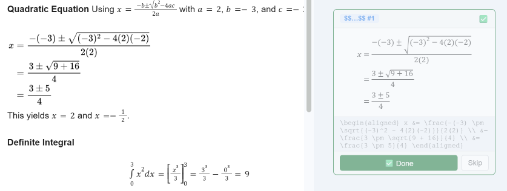
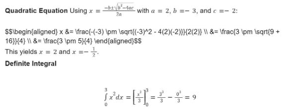

<!-- Sources: .tmp/r265_gemini.md (measured 2026-11-24, R265): one Gemini answer with 8 formulas (6 inline, 1 single-line display, 1 multi-line aligned display); copy button (two accounts), select + Ctrl+C and Export to Docs (one account). Every time, 7 of 8 became Docs equations and the aligned block stayed as LaTeX text. Live LaTeXFlow (installed listing): Scan Document = Found 1 (display 1) + Native equations 7; Convert All 1 / 1. Earlier: R195 (2026-11-03, an answer with single-line formulas only: 16 of 16 native on both accounts). Docs' own equations hold one line (R192). -->

Most of the time, Gemini's maths arrives in Google Docs™ as equations already. Copy the answer and paste it, or send it with Gemini's **Export to Docs**, and inline and single-line formulas come in as Docs equations, with nothing for you to do.

The exception we measured is the **multi-line block**: a derivation Gemini writes as `$$\begin{aligned} … \end{aligned}$$`. That one arrived as LaTeX text in every way we tried. The free LaTeXFlow add-on turns it into an equation with two clicks: **Scan Document**, then **Convert All**.

## 1. What we tested

On 24 November 2026 we asked Gemini one question: solve 2x² − 3x − 2 = 0 with the quadratic formula as a short aligned derivation, then evaluate the integral of x² from 0 to 3. The answer had 8 formulas: 6 inline, 1 single-line display (the integral) and 1 multi-line display (the three-line derivation).

![A Gemini answer: a "Quadratic Equation" heading with the quadratic formula inline, a three-line derivation x = (−(−3) ± √((−3)² − 4(2)(−2)))/2(2) = (3 ± √(9 + 16))/4 = (3 ± 5)/4 aligned on the equals signs, "This yields x = 2 and x = −1/2", and a "Definite Integral" heading with ∫₀³ x² dx = [x³/3]₀³ = 3³/3 − 0³/3 = 9; under it the row of buttons, with the pointer on the copy button and its Copy response tooltip](/assets/img/posts/2026-11-27/01-gemini-answer-copy.png){: width="680" }

We then moved the answer into a new Google Docs™ document three ways:

| How | Inline (6) | Single-line display (1) | Multi-line `aligned` (1) |
|---|---|---|---|
| Copy button, then `Ctrl+V` (two accounts) | Docs equations | Docs equation | **LaTeX text** |
| Select the answer, `Ctrl+C`, `Ctrl+V` | Docs equations | Docs equation | **LaTeX text** |
| Gemini's **Export to Docs** | Docs equations | Docs equation | **LaTeX text** |

Seven of eight became equations every time; the aligned block never did. A likely reason: an equation made with Docs' own editor holds a single line, so a three-line derivation has nowhere to go. In an earlier test (3 November 2026), an answer with single-line formulas only came through with all 16 as Docs equations.

Gemini and Google Docs™ both change over time, so read this as what happened on that date, not as a promise.

## 2. Spot the formula that stayed as text

After the paste, look for a line that starts with `$$` and shows LaTeX commands such as `\begin{aligned}`, `\frac` and `\\`. That is the one to convert; the formulas around it are already equations.

{: width="615" }

## 3. Convert it: Scan Document, then Convert All

1. Open the add-on: **Extensions → LatexFlow → Open Equation Panel**. First time? [How to Use LaTeX in Google Docs™](/blog/en/posts/convert-latex-in-google-docs/) goes through installing it.
2. On the **Scan** tab, press **🔍 Scan Document**. Each formula still written as LaTeX gets a card with a preview. In our document it found 1, and a separate line counted the **7 native equations** Docs had already made.
3. Press **⚡ Convert All**.

{: width="295" }

The derivation becomes a rendered equation in place, its three lines still aligned on the equals signs. The card is marked **Done** and the counter reads 1 / 1.

{: width="680" }

The converted equation keeps its LaTeX. To change it, select it and press **↩ Revert to LaTeX** on the Scan tab, edit the text, and convert again.

You do not need **Also detect [ … ]** for Gemini; that option is for answers whose `\[ … \]` lost its backslashes on the way, which is more typical of ChatGPT.

## 4. Export to Docs gives the same result

Gemini can also send an answer to a new document by itself: the **⋯** (more options) button under the answer, then **Export to Docs**. With the same answer, the result matched the paste: the 7 single-line formulas were Docs equations, and the aligned block was `$$\begin{aligned}…$$` text. The same Scan Document and Convert All steps fix it.

{: width="595" }

The export also brings along the Python code Gemini ran to check its answer, as code blocks at the top of the document. Delete them if you do not need them.

## 5. A prompt that keeps the format steady

Gemini usually writes `$…$` and `$$…$$`, but the format can drift in long answers. One line at the start of the request keeps it the same:

```
Write every formula in LaTeX: $...$ for inline maths and $$...$$ for display maths.
Do not use \( \) or \[ \], and do not put formulas in code blocks.
```

For long problem sets, ask in batches of five to ten. Whatever arrives as `$…$` or `$$…$$` text, the add-on reads; it also reads `\(…\)` and `\[…\]`. Why the dollar forms are the safest to ask for is in [ChatGPT LaTeX: How to Ask for Math You Can Actually Paste Into a Document](/blog/en/posts/ask-chatgpt-for-latex-math/); the reasoning is the same for Gemini.

## 6. FAQ

**Does Gemini's LaTeX turn into equations in Google Docs™ by itself?**
Mostly, yes. In our test, every inline and single-line formula became a Docs equation, by paste and by Export to Docs. The multi-line aligned block stayed as LaTeX text.

**How do I copy LaTeX from Gemini?**
Use the copy button under the answer. In our test, selecting the answer and pressing `Ctrl+C` gave the same result.

**Why does one of Gemini's formulas show as `$$\begin{aligned}…$$` in my document?**
It is a multi-line formula, and Docs left it as text. Open LatexFlow, **Scan Document**, then **Convert All**.

**Can I get Gemini's equations into Word instead?**
For a `.docx` that holds formulas as LaTeX text, see [LaTeX to Word Equation Converter](/blog/en/posts/latex-to-word-equation-converter/).

## 7. Summary

1. Copy the Gemini answer with its **copy button** and paste it into Google Docs™, or use **Export to Docs**. Most formulas arrive as equations.
2. Look for a `$$\begin{aligned}…$$` line: multi-line formulas can stay as text.
3. **Extensions → LatexFlow → Open Equation Panel**, **Scan** tab, **🔍 Scan Document**, then **⚡ Convert All**.

Get the add-on: [LaTeXFlow for Google Docs™](https://workspace.google.com/marketplace/app/latexflow/59137436133?flow_type=2&utm_source=blog&utm_medium=post&utm_campaign=gemini-latex-google-docs). Scan and Convert All are free.
