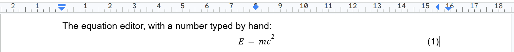
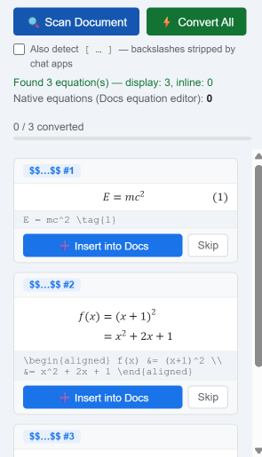
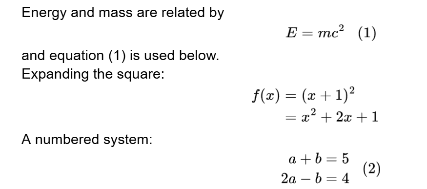

<!-- Sources: .tmp/r266_blog_queue.md (measured 2026-11-24, mathfolis.support, live LaTeXFlow from the Marketplace): Docs equation editor + centre and right tab stops set from the ruler (shot 01); $$E = mc^2 \tag{1}$$ and an aligned block with \tag{2}, Scan Document = Found 3, Convert All 3 / 3, number drawn beside the equation, image inserted on the left, centred with Ctrl+Shift+E (shots 02, 03). Docs equations have no numbering: 10-02 post table. Export keeps a written \tag: src/ExportEmit.gs (own \tag kept, R68a). -->

Google Docs™ does not number equations. Its equation editor has no numbering and no cross-references, so a number like (1) is something you add yourself. There are two ways that hold up: type the number and place it with **tab stops**, or write the equation in LaTeX with `\tag{1}` and convert it with the free LaTeXFlow add-on, which draws the number as part of the equation.

Both were tried in a real document on 24 November 2026. Here is each, with what it does and does not do.

## 1. With the Docs equation editor: tab stops

The usual layout is the equation in the middle of the line and its number at the right margin. Docs can do this with two tab stops on the equation's line.

1. Put the cursor on the line where the equation goes.
2. Click the ruler near its middle and choose the **centre** tab stop. Click the ruler near the right margin and choose the **right** tab stop.
3. Press **Tab**, insert the equation (**Insert → Equation**), click after it, press **Tab** again and type `(1)`.

The equation sits centred on the first tab stop and the number lines up with the right margin.

{: width="800" }

What it does not do: the number is plain text. If you add an equation above it, every number after it has to be changed by hand, and a reference such as "see (1)" in the text is plain text too.

## 2. With LaTeX: \tag, then Convert All

If you write the equation in LaTeX, the number can be part of it. Type the equation with its delimiters and a `\tag`:

```
$$E = mc^2 \tag{1}$$
```

`\tag` works on a multi-line block too, with one number for the block:

```
$$\begin{aligned} a + b &= 5 \\ 2a - b &= 4 \end{aligned} \tag{2}$$
```

Then open the add-on (**Extensions → LatexFlow → Open Equation Panel**), go to the **Scan** tab and press **🔍 Scan Document**. Each card's preview already shows the number.

{: width="295" }

Press **⚡ Convert All**. In our document all three converted (3 / 3). Each equation goes in on its own line at the left; to centre one, click its line and press `Ctrl+Shift+E` (Format → Align & indent → Center). The number moves with it.

{: width="680" }

What it does not do:

- The number is drawn **beside the equation**, not at the right margin. For a number at the margin, use the tab-stop layout from section 1.
- `\tag{1}` is a number you write, not a counter. Adding an equation above it does not renumber the others; change the `\tag` and convert again. To edit a converted equation, click it and press **↩ Revert to LaTeX** on the Scan tab.

If you later move the document to a LaTeX file with LaTeXFlow's Export (a paid feature), a `\tag` you wrote stays in the `.tex`, so the number comes along.

## 3. Which one to use

| | Tab stops | `\tag` + Convert All |
|---|---|---|
| Number position | right margin | beside the equation |
| Equation | Docs equation, editable in Docs | image, keeps its LaTeX for editing |
| Multi-line equations | no (one line per Docs equation) | yes, one number per block |
| Renumbering | by hand | by hand (edit the `\tag`) |

For a few short equations, tab stops are enough. For multi-line equations, or if you already write LaTeX, `\tag` is shorter.

## 4. FAQ

**Can Google Docs™ number equations automatically?**
No. The equation editor has no numbering or cross-references; numbers are added by hand or as part of a LaTeX equation.

**How do I put the equation number on the right in Google Docs™?**
Add a right tab stop at the right margin (click the ruler), press Tab after the equation and type the number (section 1).

**Does `\tag` work in Google Docs™?**
Not in Docs' own equation editor. Written as LaTeX text and converted with LaTeXFlow's Scan and Convert All, it does: the number is drawn with the equation.

More on the equation editor itself: [How to Insert an Equation in Google Docs™ (With Shortcuts)](/blog/en/posts/google-docs-equation-editor-typing-and-limits/). For aligning several lines, see [LaTeX Equation on Multiple Lines](/blog/en/posts/latex-equation-multiple-lines/).

## 5. Summary

1. Docs editor only: centre tab + right tab on the line, then equation, Tab, `(1)`.
2. With LaTeX: `$$… \tag{1}$$`, then **Scan Document** and **Convert All** in LaTeXFlow; centre the line with `Ctrl+Shift+E`.
3. Either way, numbers are yours to keep in order.

Get the add-on: [LaTeXFlow for Google Docs™](https://workspace.google.com/marketplace/app/latexflow/59137436133?flow_type=2&utm_source=blog&utm_medium=post&utm_campaign=number-equations-in-google-docs). Scan and Convert All are free.
